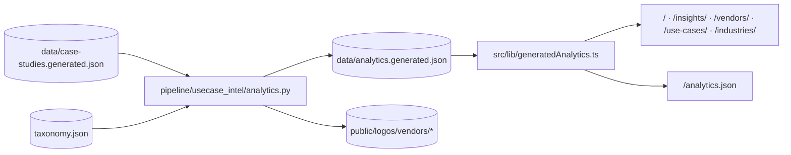

# Multi-Dimensional Analytics & Intelligence Engine

Customer Use Case Intelligence includes a workflow-integrated Python analytics engine ([`pipeline/usecase_intel/analytics.py`](../pipeline/usecase_intel/analytics.py)) that transforms the normalized case study corpus into deep, multi-dimensional benchmarks.

It runs automatically as the final step of `npm run data:build` (`npm run data:analytics`), writing `data/analytics.generated.json` for Astro build-time rendering and publishing `/analytics.json` on the deployed site.

---

## 1. Workflow Integration

Whenever new customer stories are extracted or enriched:

1. `npm run data:build` invokes `python3 -m pipeline.usecase_intel.analytics`.
2. `analytics.py` parses all real records (`is_sample != True`) and computes global distributions, cross-dimensional benchmarks, and entity-level dossiers for every vendor, use case, and industry.
3. `analytics.py` verifies that every vendor present in `taxonomy.json` or the dataset has an official brand logo mapped in `src/lib/vendors.ts` and present in `public/logos/vendors/`. If a newly added vendor lacks a logo file, a clean fallback SVG badge is generated automatically and logged as a warning until an official asset is added.

---

## 2. Analytical Dimensions Computed

### A. Quantified ROI & Numeric Metric Benchmarks (`roi_benchmarks`)

The engine parses raw `metrics[]` strings across all records (~9,150+ metric statements) and extracts numeric claims alongside their outcome categories:

- **Percentage Improvements (`1%–99.9%`)**: Computes **Median** and **75th Percentile (P75)** percentage gains per `outcome_category` (e.g., *Cost Reduction*, *Productivity Improvement*, *Speed to Market*, *Customer Experience*) as well as the global median and P75 across the entire catalog.
- **Scale & Speed Multipliers (`1.5x–1000x`)**: Counts and indexes verified `Nx` acceleration or throughput claims per outcome category.
- **High-Signal Sample Claims**: Attaches representative `{customer_name, vendor, slug, metric}` examples to each outcome benchmark.

### B. 6-Layer Enterprise AI Architecture Anatomy (`architecture_stack`)

Every record's `solution_components[]` is normalized against the six canonical architecture layers in `taxonomy.json`:

1. **`Serving`** — Model inference endpoints, AI copilots, conversational interfaces, and real-time APIs.
2. **`Compute`** — Model training, fine-tuning, GPU clusters, distributed data processing, and serverless execution.
3. **`Storage`** — Lakehouses, vector databases, object stores, feature stores, and operational databases.
4. **`Orchestration`** — Multi-agent routing, workflow engines, RAG pipelines, and prompt orchestration frameworks.
5. **`Ingest`** — Streaming event buses, ETL/ELT connectors, document OCR/parsing, and CDC pipelines.
6. **`Governance`** — Guardrails, observability, evaluation, access control, lineage, and compliance controls.

For each layer, `analytics.py` computes:
- Total component deployments and share of the global stack.
- Distinct story coverage (`case_count` and `case_share`).
- Top 8 deployed products/services within that layer (`top_products`).
- Top 5 vendors leading deployments in that layer (`top_vendors`).

### C. Product & Model Ecosystem + Co-Deployment Graph (`product_ecosystem`)

Across 4,100+ distinct products, models, and services:
- **`top_products`**: Top 40 most deployed AI products/services with story count, primary vendor, dominant architecture layer, and top use cases.
- **`co_occurring_pairs`**: Top 30 product pairs most frequently deployed together inside the same customer architecture (`product_a`, `product_b`, `count`, `top_vendor`, `top_use_case`).

### D. Global Macro-Region & Organization Scale (`geography_and_scale`)

- **Macro-Region Classification (`classify_macro_region`)**: Normalizes free-form country/region strings into 7 macro-regions:
  - `North America`
  - `Europe`
  - `Asia-Pacific`
  - `Global / Multi-region`
  - `Latin America`
  - `Middle East & Africa`
  - `Not documented`
- **Per-Region Intelligence**: Story count, catalog share, top 5 vendors, and top 4 use cases per macro-region.
- **Organization Scale Distribution**: Breakdown across `Enterprise`, `Mid-market`, `SMB`, `Public sector`, and `Not documented` with average reference value score and quantified metric rate per segment.

### E. Entity-Level Deep Dossiers (`vendor_dossiers`, `use_case_dossiers`, `industry_dossiers`)

Every vendor (`/vendors/[slug]/`), use case (`/use-cases/[slug]/`), and industry (`/industries/[slug]/`) receives a dedicated `EntityDossier` containing:

- **Quality & Depth KPIs**: `count`, `share`, `avg_value_score`, `avg_confidence` (`%`), `avg_maturity`, `quantified_metric_rate` (`%`), `deep_architecture_rate` (`%`), and `median_pct_improvement`.
- **Cross-Dimensional Top Lists**: `top_products`, `top_counterparts` (top industries for vendors/use-cases; top use cases for industries), `top_secondary` (top use cases for vendors; top vendors for use-cases/industries), `top_technical_areas`, and `top_outcomes`.
- **6-Layer Architecture Signature (`layer_distribution`)**: Exact component count and share across `Serving`, `Compute`, `Storage`, `Orchestration`, `Ingest`, and `Governance`.
- **Footprint Distributions**: `macro_regions` and `company_sizes`.
- **Top Co-Deployed Product Pairs (`co_occurring_products`)**: Top 5 product pairs deployed together within that specific vendor, use case, or industry.
- **Flagship Reference Cases (`flagship_cases`)**: Top 3 highest-value quantified deployments with headline metrics.

---

## 3. Where Analytics Are Rendered

| Route | Analytics Panels Powered by `data/analytics.generated.json` |
| :--- | :--- |
| **`/` (Home)** | Quantified ROI strip, Top Co-deployed AI Product Pairs, and Global Macro-Region footprint. |
| **`/insights/`** | Dedicated sections for Quantified ROI Benchmarks (Median/P75 `%` + `X` multipliers), 6-Layer Enterprise AI Architecture Anatomy, Co-deployed Product Pairs, and Global Macro-Region & Organization Scale. |
| **`/vendors/`, `/use-cases/`, `/industries/`** | Top-4 Ecosystem Leaders / Core Production Patterns spotlight cards, client-side sorting by Story Count / Value Score / Quantified ROI `%` / A–Z, 6-layer architecture signature mini-bars, top deployed products, and flagship customer metrics. |
| **`/vendors/[slug]/`, `/use-cases/[slug]/`, `/industries/[slug]/`** | 4-panel **Deep Intelligence Brief** (6-Layer Architecture Breakdown, Top Products & Co-deployed Pairs, Sector/Region/Scale Footprint, and Verified Outcome Benchmarks). |
| **`/analytics.json`** | Full machine-readable JSON export for external consumption. |
