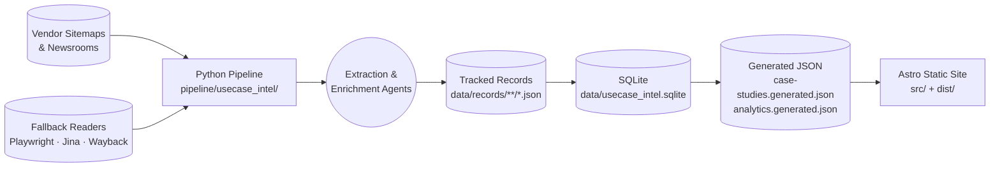

# System Architecture & Data Model

This document describes the end-to-end architecture, runtime boundaries, storage contracts, and record schemas for **Customer Use Case Intelligence**.

---

## 1. Architectural Overview

Customer Use Case Intelligence separates **data ingestion & normalization** (Python) from **presentation & search** (Astro + Pagefind). All state transitions happen through deterministic files in `data/` so that pipeline runs are idempotent, auditable, and reproducible without external database servers.



### Two Cooperating Runtimes

| Runtime | Location | Responsibilities |
| :--- | :--- | :--- |
| **Python Pipeline** | `pipeline/usecase_intel/` | Sitemap/index discovery, multi-strategy fetching, HTML/PDF cleaning, deterministic triage, extraction bundle generation, company/date provenance enrichment, deterministic rubric scoring, SQLite seeding, weekly partitioning, and multi-dimensional analytics generation. |
| **Astro Frontend** | `src/` | Build-time static generation of the home dashboard, `/insights/`, `/explore/`, `/browse/`, facet directories (`/vendors/`, `/use-cases/`, `/industries/`), entity dossier pages, individual case research briefs (`/cases/[slug]/`), and JSON/RSS feeds. |

---

## 2. End-to-End Data Flow

```mermaid
flowchart TD
  src[data/sources.json] -->|discover.py| disc[data/discovered_urls.jsonl]
  disc -->|triage.py --stage pre| triage[data/triage.jsonl]
  disc -->|fetch.py| raw[data/raw_content/{vendor}/{sha256}.*]
  raw -->|triage.py post + metadata + dates| triage
  raw -->|extract.py + clean.py + media.py| job[data/extract_jobs/{vendor}/{sha256}.json]
  job -->|case-study-extraction skill| rec[data/records/{vendor}/{slug}.json]
  enr[data/company-enrichment.jsonl] --> merge
  rec -->|merge_records.py| merge[data/case-studies.merged.json]
  merge -->|seed.py + scoring.py + storage.py| sqlite[(data/usecase_intel.sqlite)]
  sqlite -->|export.py| gen[data/case-studies.generated.json]
  gen -->|partition.py| weekly[data/weekly/{year}/{YYYY-Www}.json]
  gen -->|analytics.py| analytics[data/analytics.generated.json]
  gen -->|astro build| dist[dist/ Static HTML + /data.json + /analytics.json]
  analytics -->|astro build| dist
  dist -->|pagefind| pf[dist/pagefind/ Search Index]
```

### Build Pipeline (`npm run data:build`)

Running `npm run data:build` executes five deterministic steps in sequence:

1. **`merge_records.py`** — Walks `data/records/**/*.json`, applies validated customer headquarters/size profiles from `data/company-enrichment.jsonl`, attaches confirmed date provenance from `data/triage.jsonl`, and writes `data/case-studies.merged.json`.
2. **`seed.py`** — Recomputes deterministic **Evidence Confidence (0–100%)**, **Customer Reference Value (0–100)**, and **Evidence Stage (0–6)** scores (`scoring.py`) and upserts all records into `data/usecase_intel.sqlite` (`storage.py`).
3. **`export.py`** — Exports canonical records ordered by `(vendor, customer_name)` to `data/case-studies.generated.json`.
4. **`partition.py`** — Assigns each record to its immutable ISO collection week (`data/weekly/{year}/{YYYY-Www}.json`) and stamps `collected_at` and `collected_week` back onto `data/case-studies.generated.json`.
5. **`analytics.py`** — Computes granular multi-dimensional analytics (`data/analytics.generated.json`) and verifies that every vendor in `taxonomy.json` has a synchronized logo asset in `public/logos/vendors/`.

---

## 3. Core Data Contracts

### `CaseStudyRecord` Schema

Defined in [`src/lib/types.ts`](../src/lib/types.ts) and validated in [`pipeline/usecase_intel/models.py`](../pipeline/usecase_intel/models.py):

```ts
export interface SolutionComponent {
  name: string;   // Exact product/service name from source
  role: string;   // Specific deployment role in one sentence
  layer?: string; // Ingest | Compute | Storage | Serving | Orchestration | Governance
}

export interface SourceReference {
  id: string;
  title: string;
  publisher: string;
  url: string;
  source_type: string;
  authority: string;             // First-party | Independent | Unknown
  published_date: string;        // YYYY-MM-DD or "unknown"
  published_date_source: string; // page | page metadata | vendor metadata | unknown
  retrieved_at: string;          // ISO 8601 timestamp
  supports: string[];            // Record fields backed by this source
  evidence?: string;             // Verbatim enrichment fact when applicable
}

export interface DateEvidence {
  date: string;
  type: string;      // Published on source page | Publisher catalog date | First archived | Sitemap last modified | Unverified extracted date
  publisher: string;
  url: string;
  authority: string;
}

export interface CaseStudyRecord {
  id: string;
  slug: string;
  vendor: string;
  customer_name: string;
  industry: string;
  region: string;
  company_size: string;          // Enterprise | Mid-market | SMB | Public sector | Unknown
  business_problem: string;
  solution_summary: string;      // 600–1000 chars covering ingest -> compute -> storage -> serving
  products_used: string[];       // Mirrors solution_components[].name
  solution_components?: SolutionComponent[];
  data_flow?: string;
  integration_points?: string[];
  technical_area: string[];
  use_case_category: string[];
  business_outcome: string;
  outcome_category: string[];
  metrics: string[];
  architecture_clues: string[];
  source_url: string;
  source_language?: string;      // Present for translated non-English sources (e.g., "zh")
  published_date: string;
  published_date_source?: string;
  date_evidence?: DateEvidence[];
  source_references?: SourceReference[];
  field_sources?: Record<string, string[]>;
  confidence_score: number;      // 0.0 – 1.0
  confidence_breakdown?: ScoreCriterion[];
  maturity_score: number;        // 0 – 6
  value_score?: number;          // 0 – 100
  value_breakdown?: ScoreCriterion[];
  evidence_quotes: string[];
  collected_at?: string;
  collected_week?: string;
  is_sample?: boolean;
}
```

### Provenance & Publication-Date Policy

1. **Strict Publication Dates**: Only dates explicitly stated on the story page or in documented publisher catalog metadata are stored in `published_date`.
2. **Non-Publication Date Signals**: Sitemap `lastmod` timestamps, Internet Archive first-capture dates, and unverified extracted dates are preserved in `date_evidence[]` with their exact label and never masquerade as publication dates.
3. **Field-Level Source Attribution**: Every consulted page is recorded in `source_references[]` and linked via `field_sources`. Company headquarters region and employee-size enrichments (`data/company-enrichment.jsonl`) never overwrite authored values and always cite an opened primary/secondary source.

---

## 4. Controlled Taxonomy (`taxonomy.json`)

[`taxonomy.json`](../taxonomy.json) defines the canonical vocabulary shared across the extraction skill, Python normalization, and Astro UI:

- **`vendors`** — 51 global cloud, AI model, data platform, enterprise SaaS, Chinese cloud, and global consulting providers.
- **`industries`** — 13 normalized industry verticals (never `unknown`).
- **`technical_areas`** — 15 technical domains (e.g., `Generative AI`, `AI Agents`, `Retrieval-Augmented Generation`, `Machine Learning`, `Computer Vision`).
- **`use_case_categories`** — 15 core business AI workflow patterns.
- **`outcome_categories`** — 8 business impact categories (`Productivity Improvement`, `Customer Experience`, `Speed to Market`, `Cost Reduction`, `Scalability`, `Revenue Growth`, `Risk Reduction`, `Compliance`).
- **`component_layers`** — 6 enterprise architecture stack layers (`Ingest`, `Compute`, `Storage`, `Serving`, `Orchestration`, `Governance`).

---

## 5. Repository Structure & Tracking Policy

```text
usecase/
├── README.md                              Quickstart and operational guide
├── ARCHITECTURE.md                        High-level architectural overview
├── docs/                                  Detailed engineering documentation
│   ├── README.md                          Documentation index
│   ├── architecture.md                    System architecture & data contracts
│   ├── pipeline-and-workflows.md          Ingestion, triage, enrichment & CI/CD
│   ├── analytics-and-intelligence.md      Multi-dimensional analytics & ROI engine
│   └── ui-and-design-system.md            Typography, tokens, logos & UI components
├── taxonomy.json                          Canonical controlled vocabulary
├── package.json · astro.config.mjs        Frontend build & pipeline scripts
├── requirements.txt                       Python dependencies
├── public/
│   └── logos/vendors/                     52 official brand logos (SVG/PNG/ICO)
├── src/
│   ├── components/                        Reusable Astro UI components
│   ├── layouts/BaseLayout.astro           Global shell, navigation & JSON/RSS links
│   ├── lib/                               Typed data loaders, analytics, icons & facets
│   ├── pages/                             Static routes & JSON/RSS endpoints
│   ├── scripts/                           Client-side Pagefind card renderer
│   └── styles/global.css                  Design tokens & stylesheet
├── pipeline/usecase_intel/                Python ingestion, scoring & analytics modules
├── tests/                                 Python unit test suite
└── data/
    ├── sources.json                       Vendor sitemap & crawl configurations (tracked)
    ├── records/{vendor}/{slug}.json       Normalized case study records (tracked)
    ├── company-enrichment.jsonl           Customer region & size ledger (tracked)
    ├── triage.jsonl                       URL triage & date-provenance ledger (tracked)
    ├── weekly/                            Immutable ISO week partitions (tracked)
    ├── case-studies.generated.json        Built dataset consumed by Astro (gitignored)
    ├── analytics.generated.json           Built multi-dimensional analytics (gitignored)
    └── usecase_intel.sqlite               Built SQLite database (gitignored)
```
